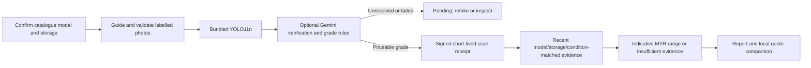

# ReValue AI FYP1 system handoff

Scope: demonstrate the application with the bundled YOLO11n and explain its evidence limits. Independent detector comparison and the annotated dataset are deferred to FYP2.

## Requirements and verification

| Need | Acceptance rule | Verification |
| --- | --- | --- |
| Guided assessment | Confirm catalogue identity and storage; accept labelled, distinct exterior photos; reject malformed or repeated uploads. | HTTP and browser workflow tests. The current UI asks for five views; the API requires front and back. |
| Conditional grade | Show a provisional grade for supported YOLO-only observations. Hold the grade pending on detector failure, ambiguous damage, or unresolved verification. | Regression tests cover failures, disputed evidence, and verifier-only uncertain findings. |
| Evidence-based resale | Only current, distinct Malaysian MYR observations for the same model, storage and exterior condition may support a live price. Fewer than three means insufficient evidence. | Valuation tests and browser checks cover unavailable providers and source display with a fixture. The checked Malaysian listings were inaccessible from this workspace. |
| Explainable options | Use user-entered net offers and repair costs. Compare at least two complete sale options, explain ties and missing quotes, and support a keep goal without claiming a functional diagnosis. | Quote calculation unit checks and browser form interaction. |
| Honest report | Explain the grade basis, distinguish demo values, avoid simulated figures in the live report, and reset quote inputs and report identity between assessments. | Browser regression checks with generated inputs. |
| Privacy | Gemini upload verification is opt-in in the browser. Local YOLO can run without a credential. The price receipt contains no images and expires. | Local workflow and receipt tests. Production access control and storage policies are outside the prototype. |

## Architecture and decision methodology



- The scan receipt binds the issued grade and evidence basis to canonical catalogue ID and storage for 15 minutes. It uses a per-process key and is lost on server restart. A direct scenario API can still accept a manual grade, which its response identifies as manual. The browser uses the receipt route and cannot use a pending scan to retrieve a price.
- YOLO confidence is a detection score rather than damage severity. No detections produce an explicitly provisional grade and an inspection reminder. A verifier-only candidate or disagreement needs review before valuation. Internal condition and function are unassessed.
- Use the interquartile range, rounded to RM50, for at least three qualifying observations. Asking and retail prices may differ from transaction prices. Comparisons against working phones assume the assessed phone also works, which requires a separate check. Search grounding matches the source link. Dated operator-reviewed observations can be supplied separately. Archived calibration values are illustrative.
- For sale intent, compare net as-is offers, usable trade-in credit, and net post-repair sale offers minus repair cost. Amounts are entered by the user. Treat trade-in credit as comparable only if the user plans to spend it. Incomplete or tied comparisons ask for quotes or a decision based on non-price costs. A keep goal prompts an inspection if damage affects use. The calculator does not predict repair success, merchant behaviour or internal condition.

## Run and demonstrate locally

From the repository root using the [FYP environment](README.md):

```bash
export YOLO_CONFIG_DIR="$PWD/.revalue-runtime/yolo" MPLCONFIGDIR="$PWD/.revalue-runtime/matplotlib"
export OMP_NUM_THREADS=2 YOLO_AUTOINSTALL=false
python -c 'from backend.src.server import run; run(host="127.0.0.1")'
```

Open `http://127.0.0.1:8765`, select the device and storage, upload separate photos for the five requested views, and run the scan. Leave Gemini unchecked to keep the photos on the local server. Open the exterior report when the scan produces a grade. The report can show an insufficient-evidence message instead of a number. Try **Compare your options** with actual quotes, or use clearly labelled illustrative amounts in a presentation. The shops directory and conversations are simulations. The report ID identifies the assessment in this browser session.

To enable operator-reviewed evidence, set `REVALUE_AUDITED_MARKET_CSV` to an authorized private CSV. Required fields:

```text
source,source_url,observed_at,country,currency,brand,model,storage,condition,price,price_type,review_reference
```

Use direct HTTPS listing URLs, a date when you actually observed the price, country MY, currency MYR, and a private review reminder in `review_reference`. Do not insert assumed or generated prices. Keep the CSV and any private documentation outside Git. The exporter does not expose the review reference. There is no configured audited CSV in the cloud tests. The proxy blocked the checked Carousell, Mudah and 3Cat listing hosts. Provider credentials and commissioned market access remain outside this pass.

## FYP1 and FYP2 boundary

For FYP1, demonstrate the photo-to-report path, the uncertainty gate, evidence provenance and the quote rules. Cite test outputs as software verification. The earlier six-image Houdan probe is qualitative and should not support a comparative accuracy claim.

For FYP2, collect consented and independently labelled photographs with device/session provenance and documented clean views. Freeze a held-out set and evaluate the original model and experimental Houdan under the same conditions. Preserve licence and source metadata and keep the historical benchmark separate. [FYP2 benchmark plan](BENCHMARK_HANDOFF.md) · [Literature research notes](LITERATURE_NOTES.md)

## Verified local results, 19 November 2026

The backend suites, benchmark tooling checks, and quote calculation unit checks passed. Chromium exercised catalogue and storage confirmation, distinct photo uploads, a review-required response that left pricing blocked, a real bundled YOLO11n run on software fixture images, the receipt-backed no-evidence report, fixture source links, quote calculation, and a fresh report after replacing a photo. A second Chromium context with a mobile viewport opened the QR link, uploaded and sent five views, and the first context received them. Physical cross-device capture, Gemini, and marketplace access remain unverified.

The bundled detector SHA-256 remained `b26c49987eb44ab60ba0368420b5aa6fa89462b72212d5a83773aabc9a1d543f`. The limited qualitative probe used six CC BY 4.0 Broken Interfaces display crops at revision `37877e61c93e17975a8a5968baefad3dba0b3231` (sorted indices 4, 18, 33, 48, 63 and 78, zero-based). Each crop was passed individually with the application's bundled checkpoint and default 640-pixel input and confidence policy. The detector emitted a crack box on BI-03 and BI-06, and no boxes on BI-01, BI-02, BI-04 and BI-05. Prior visual review noted apparent damage on several images that returned no boxes. Accuracy metrics require independent labels and a suitable holdout. All six crops were treated as single front views. Images and overlays stayed outside Git. [Source and licence](https://github.com/MHCI/broken-interfaces/tree/37877e61c93e17975a8a5968baefad3dba0b3231)
