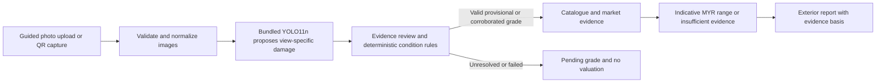

# ReValue AI FYP1 methodology and evidence outline

Use this outline to discuss the implementation and proposed experiments in your own words. Keep implementation verification, qualitative model observations and independent quantitative results in separate sections of the report.

## System architecture

The app confirms the model and storage through the phone catalogue. Bounding boxes are candidate observations, and model confidence does not measure damage severity. The grade combines visible damage with view context under fixed rules. Gemini corroboration is optional and does not replace human inspection. Explain why a provisional grade can be revised, why a missing detection is not proof of a clean device, and why a market range is conditional on available observations or labelled local calibration.

Benchmark annotation, adjudication and model experiments run off the application path. Houdan remains a separate experimental checkpoint. Its `crack` output is normalized only in the comparison; bump and paint are counted separately and do not influence ReValue grading.

## Data and ground truth

1. Record where each photo came from, permission and applicable licence, and its association with a physical device and capture session. Freeze model hashes before acquiring a new holdout when training membership is unknown. Keep identifying data and raw photos out of Git.
2. Use the ten practice crops to calibrate mark type, connected crack networks and box extent. Have each person annotate independently with model output hidden. Compare disagreement about disposition, class and box extent and document the rule agreed for future annotation. The practice labels are neither training labels nor measurement results.
3. Collect consented eligible front, rear and side photos with realistic lighting. Include clear negative examples and confusing patterns such as reflections, seams and fingerprints. Require explicit review of clean photos and exclude cases where the surface cannot be read consistently. Source dataset annotations and optional training proposals aid preparation but do not establish ground truth.
4. Screen corrupt files and duplicate candidates. Treat matching hashes as evidence of duplicated files or pixels. Treat perceptual matches as candidates for review. Group by verified physical phone and session across sources. Keep all related images in one split, freeze the test manifest, and keep it blind during threshold or augmentation selection.

## Experiments and interpretation

| Question | Method | Evidence to report |
| --- | --- | --- |
| Can the historical ReValue baseline be reproduced? | Recover the exact original held-out data and evaluation settings. | Historical figures remain attributed. A new eligible split measures external performance instead. |
| Do the pinned detectors differ on a common independent set? | Same manifest, square 640 and 960 inputs, batch-one FP32 CPU, same class-aware matching and suppression configuration. | Per-class precision, recall, F1, AP@50 and AP@50–95; aggregate mAP; false positives, missed detections, and median/p95 CPU latency. |
| Would a change improve results? | After the baseline, test a control and one realistic augmentation or architecture change with an identical training budget and frozen evaluation protocol. | Report validation decisions, seeds, independent comparison, and uncertainty sampled by phone or session. Avoid choosing settings using test results. |

Use the fixed operating point to report actual TP/FP/FN counts. AP summarizes ranked detections across confidence thresholds; mAP averages over the common classes. Inspect failures privately by image ID. For the display demo, distinguish software behaviour verified with fixtures from model performance measured on independently labelled devices.

## Evidence currently available

- [Technical handoff and verification](TECHNICAL_HANDOFF.md) records what ran locally, including interface and API checks.
- [Dataset audit](DATASET_AUDIT.md) records source licences, inaccessible archives, unsupported split assumptions, and the reasons the current pool is ineligible.
- [Model review](HOUDAN_V1_MODEL_REVIEW.md) documents verified weights, licence notices, and a small qualitative probe that is insufficient to compare accuracy.
- [Experiment log](experiment_log.csv) distinguishes the repository's historical figures from the blocked independent evaluation.
- [Private workflow and exact commands](BENCHMARK_HANDOFF.md) show how to reproduce preparation and run the matched comparison once both checkpoint and dataset checks pass.
